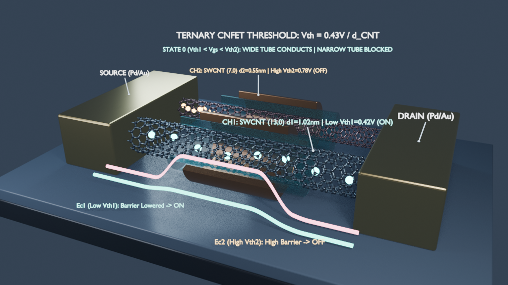
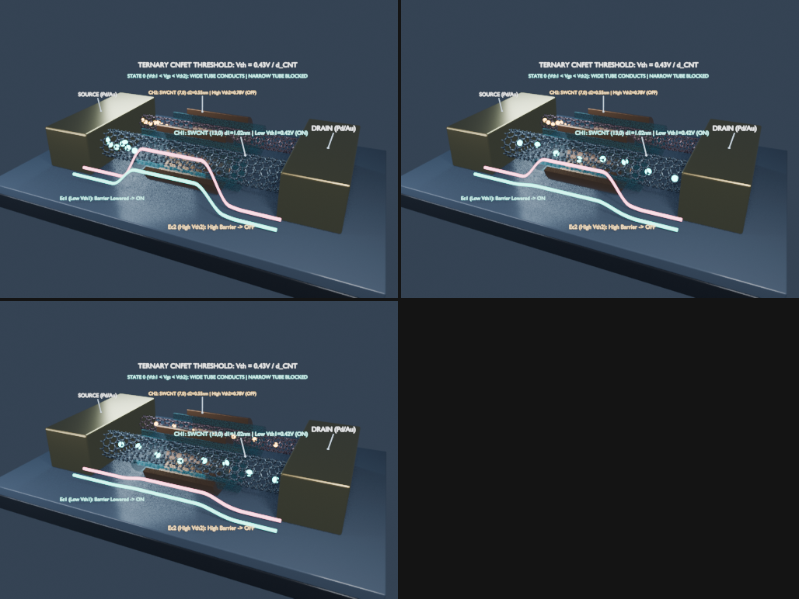
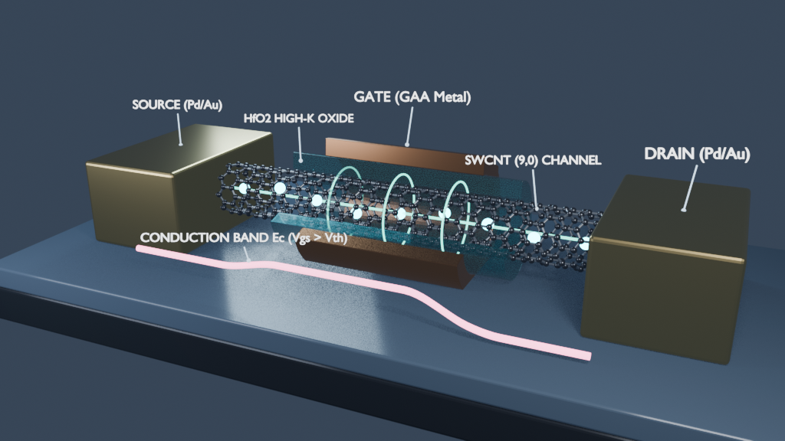
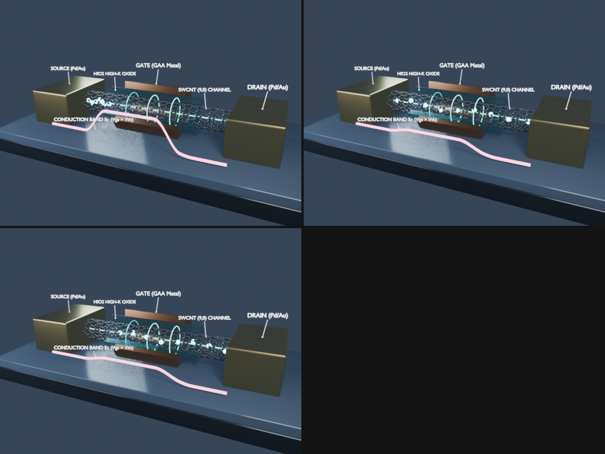

# Ternary CNFET 3D Visualization (Blender 4.5)

Procedural atomic modeling, PBR materials, and 3D operational animation of **Carbon Nanotube Field-Effect Transistors (CNFETs)** featuring a *Gate-All-Around* (GAA) architecture. This visualization demonstrates ballistic electron transport and **diameter-dependent threshold voltage modulation ($V_{th} \propto 1/d_{\text{CNT}}$)** applied to balanced ternary logic integrated circuits ($\{-1, 0, +1\}$).



---

## 1. Physical Foundation: Multi-Threshold Control via Chirality

In a CNFET, the conductive channel consists of one or more Single-Walled Carbon Nanotubes (SWCNTs). For semiconducting zigzag $(n, 0)$ nanotubes, the physical diameter $d_{\text{CNT}}$, the bandgap energy $E_g$, and the threshold voltage $V_{th}$ follow these analytical relationships:

$$d_{\text{CNT}} = \frac{\sqrt{3} a_{\text{CC}}}{\pi} n \approx 0.0783 \cdot n\text{ (nm)}$$

$$E_g \approx \frac{0.84\text{ eV}}{d_{\text{CNT}}\text{ (nm)}}, \qquad V_{th} \approx \frac{0.43\text{ V}}{d_{\text{CNT}}\text{ (nm)}}$$

By integrating two nanotubes of distinct diameters under a shared gate bus ($V_{GS}$), two active switching thresholds are achieved on the same substrate. This enables native ternary logic gates (Standard, Positive, and Negative Ternary Inverters, as well as balanced ternary architectures such as Setun and REBEL-6) without passive resistive voltage dividers:

| Parameter | Channel 1: SWCNT `(13,0)` (Front) | Channel 2: SWCNT `(7,0)` (Rear) |
| :--- | :---: | :---: |
| **Physical Diameter ($d_{\text{CNT}}$)** | $1.02\text{ nm}$ | $0.55\text{ nm}$ |
| **Threshold Voltage ($V_{th}$)** | **$V_{th1} \approx 0.42\text{ V}$ (Low)** | **$V_{th2} \approx 0.78\text{ V}$ (High)** |
| **Generated Atomic Mesh (`bmesh`)** | 726 C atoms ($sp^2$), 1078 $\sigma$ bonds | 518 C atoms ($sp^2$), 770 $\sigma$ bonds |
| **State `-1` ($V_{GS} < 0.42\text{ V}$)** | Blocked (High $E_{C1}$) | Blocked (High $E_{C2}$) |
| **State `0` ($0.42\text{ V} \le V_{GS} < 0.78\text{ V}$)** | **Ballistic Conduction (Low $E_{C1}$)** | **Blocked (High $E_{C2}$)** |
| **State `+1` ($V_{GS} \ge 0.78\text{ V}$)** | Ballistic Conduction (Low $E_{C1}$) | **Ballistic Conduction (Low $E_{C2}$)** |

---

## 2. Operational State Gallery

### Progression Across the 3 Balanced Ternary States (`-1`, `0`, `+1` at Frames 20, 85, and 160)


### Single-Channel `SWCNT (9,0)` Anatomy and Ballistic Transport




---

## 3. Repository Structure

* [`AGENTS.md`](AGENTS.md): Technical onboarding guide, mathematical lattice invariants, MCP verification workflow, and pedagogical extension roadmap for autonomous coding agents.
* [`video/ternary_cnfet_educational_video.mp4`](video/ternary_cnfet_educational_video.mp4): Complete 1080p 30 FPS educational video combining 3D Blender EEVEE Next animations, a 1080p Manim mathematical plot of $V_{th}(d_{\text{CNT}})$, React/TypeScript scientific HUD overlays rendered with Remotion + Bun, and neural American English narration.
* [`remotion-video/`](remotion-video/): Remotion project powered by Bun (`src/Composition.tsx`, `src/Root.tsx`) with installed Remotion agent skills (`.agents/skills/remotion-*`).
* [`scripts/manim_chirality_plot.py`](scripts/manim_chirality_plot.py) & [`scripts/generate_voiceover.py`](scripts/generate_voiceover.py): Manim mathematical plot generator and neural TTS narration pipeline.
* [`blend/cnfet_ternary_threshold.blend`](blend/cnfet_ternary_threshold.blend): Complete Blender 4.5 LTS scene containing the dual `SWCNT (13,0)` and `SWCNT (7,0)` channels, Palladium/Gold ($\text{Pd}/\text{Au}$) ohmic contacts, cutaway $\text{HfO}_2$ high-k dielectric ($\text{IOR} = 1.90$), GAA metal gate collars, emissive charge carriers, and 3D conduction band curves ($E_{C1}$, $E_{C2}$) animated via Shape Keys across frames 1 to 180.
* [`scripts/build_ternary_cnfet.py`](scripts/build_ternary_cnfet.py): Reproducible Python script (`bpy` / `bmesh`) that parametrically constructs the atomic geometry, PBR materials, three-point studio lighting, 3D annotations, and animation keyframes.
* [`renders/`](renders/): High-resolution renders captured with EEVEE Next.
* [`docs/plan.md`](docs/plan.md): Architectural specification of the scene hierarchy and collections.
* [`docs/walkthrough.md`](docs/walkthrough.md): Detailed technical walkthrough of the device physics and visual layers.

---

## 4. How to Open or Rebuild in Blender

To open the pre-built scene directly:

```bash
blender blend/cnfet_ternary_threshold.blend
```

To rebuild the entire scene from scratch using the procedural Python generator:

```bash
blender --python scripts/build_ternary_cnfet.py
```
