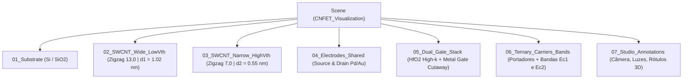

# Plano de Projeto: Visualização 3D e Funcionamento do CNFET no Blender 4.5

Este documento detalha a construção procedural, os materiais físicos (PBR) e a animação operacional de um **Transistor de Efeito de Campo de Nanotubo de Carbono (CNFET)** com arquitetura *Gate-All-Around* (GAA) e comparação de limiar ternário no Blender 4.5 via MCP.

---

## 1. Arquitetura da Cena e Organização

A cena é estruturada em coleções independentes para permitir controle de visibilidade, camadas de corte e animação paramétrica:

---

## 2. Etapas de Execução Técnica

### Etapa 1: Substrato de Silício e Isolante ($\text{Si} / \text{SiO}_2$)
1. **Base de Silício ($\text{Si}$):** Bloco inferior em $Z \in [-1.1, -0.4]$ com chanfro (*Bevel*) nas bordas.
2. **Óxido Enterrado ($\text{SiO}_2$):** Camada dielétrica planar em $Z \in [-0.4, 0.0]$, servindo de base isolante para os terminais.

### Etapa 2: Geração Paramétrica dos Nanotubos (SWCNT)
1. **Algoritmo de Rede Hexagonal (`bmesh`):**
   * Geração matemática das coordenadas cilíndricas de folhas de grafeno enroladas com quiralidade semicondutora zigzag $(n, 0)$.
   * Criação explícita de átomos de carbono (esferas em cada vértice da rede hexagonal) e ligações covalentes $\sigma$ (cilindros conectando os vizinhos imediatos).
2. **Duplo Canal para Lógica Ternária:**
   * **Canal 1 Frontal `(13,0)`:** Diâmetro $d_1 = 1.02\text{ nm}$, tensão de limiar baixa $V_{th1} \approx 0.42\text{ V}$ (726 átomos de C, 1078 ligações).
   * **Canal 2 Traseiro `(7,0)`:** Diâmetro $d_2 = 0.55\text{ nm}$, tensão de limiar alta $V_{th2} \approx 0.78\text{ V}$ (518 átomos de C, 770 ligações).

### Etapa 3: Terminais de Fonte e Dreno (Contatos Ôhmicos)
1. **Bloco de Fonte (*Source*):** Posicionado na extremidade esquerda, envolvendo ambos os nanotubos.
2. **Bloco de Dreno (*Drain*):** Posicionado de forma simétrica na extremidade direita.
3. **Geometria de Contato:** Acabamento metálico representando as vias de metalização de Paládio ($\text{Pd}$) e Ouro ($\text{Au}$).

### Etapa 4: Pilha de Porta (*Gate Stack*) com Corte em Seção (*Cutaway*)
Para exibir simultaneamente o exterior do transistor e os nanotubos internos, a região central possui um corte angular no quadrante frontal superior:
1. **Dielétrico High-k ($\text{HfO}_2$):** Cilindro oco coaxial expondo a rede atômica dos nanotubos.
2. **Eletrodo de Porta (*Metal Gate* $\text{TiN}/\text{Cu}$):** Colar metálico externo acompanhando o corte em seção para revelar a espessura do óxido de háfnio, interligado pelo barramento comum de porta (`Shared_Gate_Bus_Vgs`).

### Etapa 5: Visualização dos Três Estados Ternários (Animação de 180 Quadros)
1. **Estado `-1` ($V_{GS} < V_{th1} < V_{th2}$, Quadros 1 a 45):** Ambos os tubos permanecem bloqueados; curvas $E_{C1}$ e $E_{C2}$ com barreiras elevadas.
2. **Estado `0` ($V_{th1} \le V_{GS} < V_{th2}$, Quadros 65 a 115):** A barreira $E_{C1}$ do tubo largo $(13,0)$ abaixa e seus elétrons cianos fluem em transporte balístico rumo ao Dreno, enquanto a barreira $E_{C2}$ do tubo estreito $(7,0)$ permanece elevada, retendo os portadores âmbar na Fonte.
3. **Estado `+1` ($V_{GS} \ge V_{th2}$, Quadros 135 a 180):** Ambas as barreiras $E_{C1}$ e $E_{C2}$ abaixam e os dois nanotubos conduzem simultaneamente.
