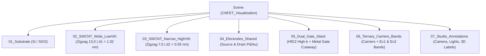

# Project Plan: 3D CNFET Visualization and Operation in Blender 4.5

This document specifies the procedural construction, physically based materials (PBR), and operational animation of a **Carbon Nanotube Field-Effect Transistor (CNFET)** featuring a *Gate-All-Around* (GAA) architecture and balanced ternary threshold comparison in Blender 4.5.

---

## 1. Scene Architecture and Organization

The scene is organized into dedicated collections for independent visibility control, cross-sectional cutaways, and parametric animation:

---

## 2. Technical Execution Stages

### Stage 1: Silicon Substrate and Buried Oxide ($\text{Si} / \text{SiO}_2$)
1. **Silicon Base ($\text{Si}$):** Lower wafer block spanning $Z \in [-1.1, -0.4]$ with beveled edges.
2. **Buried Oxide ($\text{SiO}_2$):** Planar dielectric layer spanning $Z \in [-0.4, 0.0]$, providing electrical isolation for the terminals.

### Stage 2: Parametric Generation of the Carbon Nanotubes (SWCNT)
1. **Hexagonal Lattice Algorithm (`bmesh`):**
   * Mathematical generation of cylindrical coordinates for rolled graphene sheets with semiconducting zigzag $(n, 0)$ chirality.
   * Explicit instantiation of carbon atoms (icospheres at each hexagonal vertex) and covalent $\sigma$ bonds (cylinders connecting nearest neighbors).
2. **Dual Channels for Balanced Ternary Logic:**
   * **Front Channel 1 `(13,0)`:** Diameter $d_1 = 1.02\text{ nm}$, low threshold voltage $V_{th1} \approx 0.42\text{ V}$ (726 carbon atoms, 1078 bonds).
   * **Rear Channel 2 `(7,0)`:** Diameter $d_2 = 0.55\text{ nm}$, high threshold voltage $V_{th2} \approx 0.78\text{ V}$ (518 carbon atoms, 770 bonds).

### Stage 3: Source and Drain Terminals (Ohmic Contacts)
1. **Source Block:** Positioned on the left end ($X = -4.85$), clamping both nanotubes.
2. **Drain Block:** Positioned symmetrically on the right end ($X = +4.85$).
3. **Contact Geometry:** Beveled metallic blocks representing Palladium ($\text{Pd}$) and Gold ($\text{Au}$) metallization pads.

### Stage 4: Gate-All-Around (GAA) Stack with Cross-Sectional Cutaway
To reveal the outer transistor structure and the internal nanotubes simultaneously, the central gate region includes an angular cutaway across the front-top quadrant:
1. **High-k Dielectric ($\text{HfO}_2$):** Coaxial hollow cylinder exposing the atomic lattice of both nanotubes.
2. **Metal Gate Electrode ($\text{TiN}/\text{Cu}$):** Outer metallic collar following the cross-sectional cut to reveal the hafnium oxide thickness, interconnected via a shared gate bus (`Shared_Gate_Bus_Vgs`).

### Stage 5: Visualization of the Three Balanced Ternary States (180-Frame Animation)
1. **State `-1` ($V_{GS} < V_{th1} < V_{th2}$, Frames 1 to 45):** Both nanotubes remain blocked; conduction band curves $E_{C1}$ and $E_{C2}$ exhibit high potential barriers.
2. **State `0` ($V_{th1} \le V_{GS} < V_{th2}$, Frames 65 to 115):** The potential barrier $E_{C1}$ of the wide tube $(13,0)$ drops and its cyan electrons flow ballistically toward the Drain, whereas the barrier $E_{C2}$ of the narrow tube $(7,0)$ stays elevated, confining the amber electrons at the Source.
3. **State `+1` ($V_{GS} \ge V_{th2}$, Frames 135 to 180):** Both barriers $E_{C1}$ and $E_{C2}$ drop, and both nanotubes conduct simultaneously.
