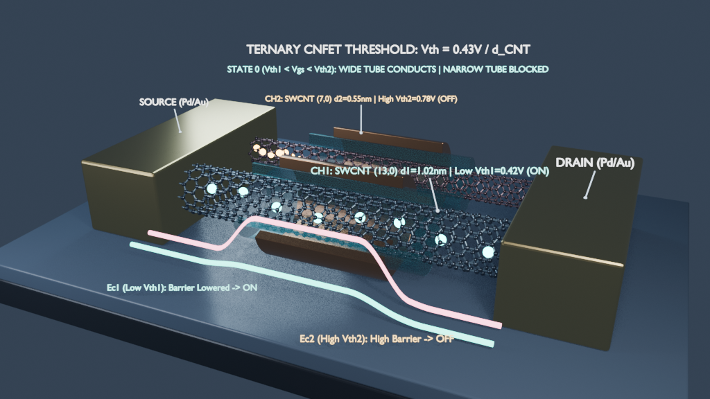
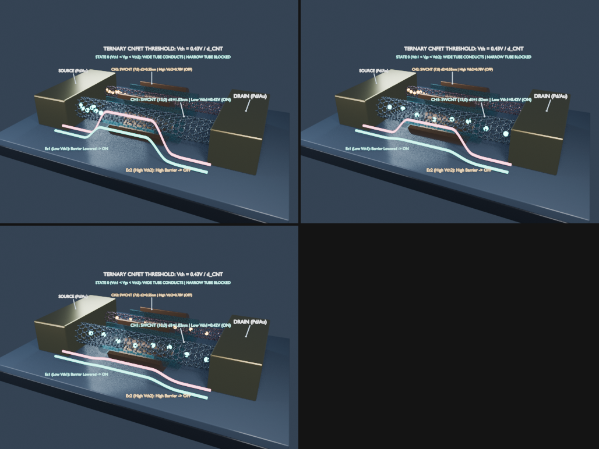
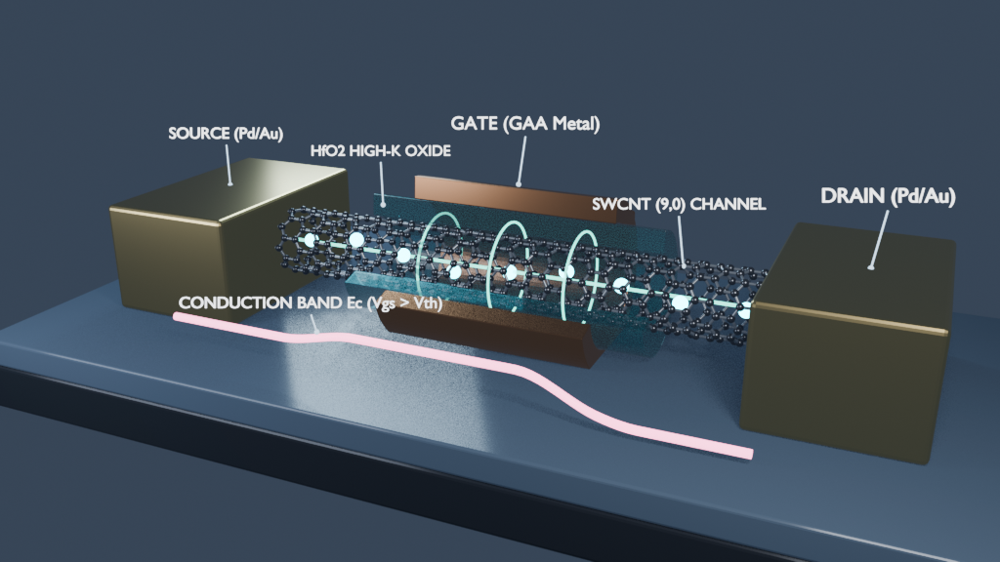
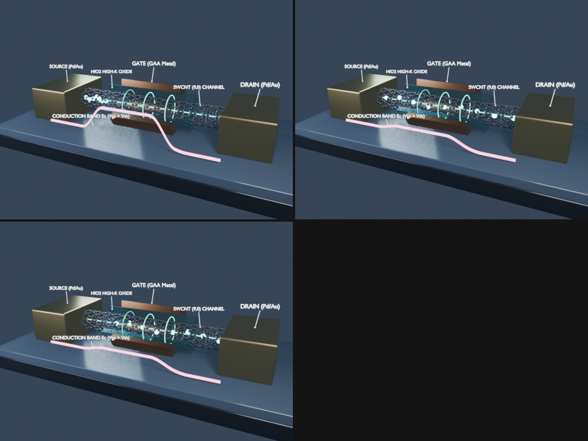

# Walkthrough: Balanced Ternary Threshold Comparison in CNFETs (Blender 4.5)

The scene in [`blend/cnfet_ternary_threshold.blend`](../blend/cnfet_ternary_threshold.blend) implements a **dual parallel channel** architecture sharing Source, Drain, and Gate bus ($V_{GS}$) terminals to physically demonstrate threshold voltage modulation in balanced ternary logic ($\{-1, 0, +1\}$).

---

## 1. Rendered Visualization of the Ternary States

### A. Ternary State `0` (Frame 85: Diameter-Selective Conduction)

### B. Full Progression Across the 3 Ternary States (`-1`, `0`, `+1`)

### C. Single-Channel `SWCNT (9,0)` Model

---

## 2. Physics of Diameter-Based Threshold Modulation ($V_{th} \propto 1 / d_{\text{CNT}}$)

The diameter of a zigzag $(n, 0)$ carbon nanotube is given by:

$$d_{\text{CNT}} = \frac{\sqrt{3} a_{\text{CC}}}{\pi} n \approx 0.0783 \cdot n\text{ (nm)}$$

Both the bandgap $E_g$ and the threshold voltage $V_{th}$ are inversely proportional to the physical diameter of the nanotube:

$$E_g \approx \frac{0.84\text{ eV}}{d_{\text{CNT}}\text{ (nm)}}, \qquad V_{th} \approx \frac{0.43\text{ V}}{d_{\text{CNT}}\text{ (nm)}}$$

| Physical and Geometric Parameter | Front Channel 1: Wide Tube `(13,0)` | Rear Channel 2: Narrow Tube `(7,0)` |
| :--- | :---: | :---: |
| **Physical Diameter ($d_{\text{CNT}}$)** | $1.02\text{ nm}$ | $0.55\text{ nm}$ |
| **Threshold Voltage ($V_{th}$)** | **$V_{th1} \approx 0.42\text{ V}$ (Low)** | **$V_{th2} \approx 0.78\text{ V}$ (High)** |
| **Atomic Geometry in Blender** | 726 C atoms, 1078 $\sigma$ bonds ($R = 0.56$) | 518 C atoms, 770 $\sigma$ bonds ($R = 0.32$) |
| **Conduction Band Curve** | `Ec1_LowVth_Wide` (Front Cyan) | `Ec2_HighVth_Narrow` (Pink/Amber) |
| **State `-1` ($V_{GS} < 0.42\text{ V}$, Frames 1 to 45)** | Blocked (High $E_{C1}$) | Blocked (High $E_{C2}$) |
| **State `0` ($0.42\text{ V} \le V_{GS} < 0.78\text{ V}$, Frames 65 to 115)** | **Conducting (Low $E_{C1}$)** | **Blocked (High $E_{C2}$)** |
| **State `+1` ($V_{GS} \ge 0.78\text{ V}$, Frames 135 to 180)** | Conducting (Low $E_{C1}$) | **Conducting (Low $E_{C2}$)** |
